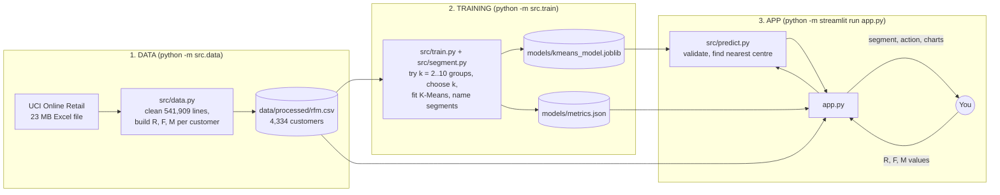
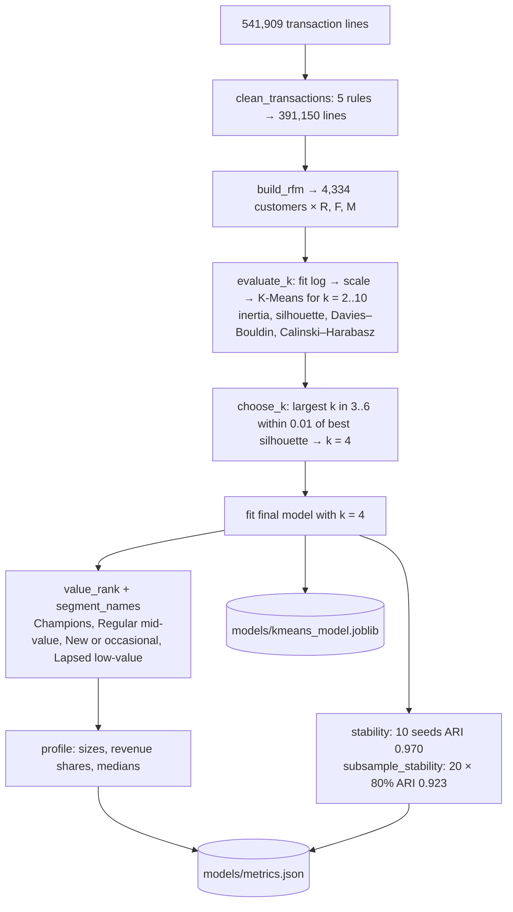
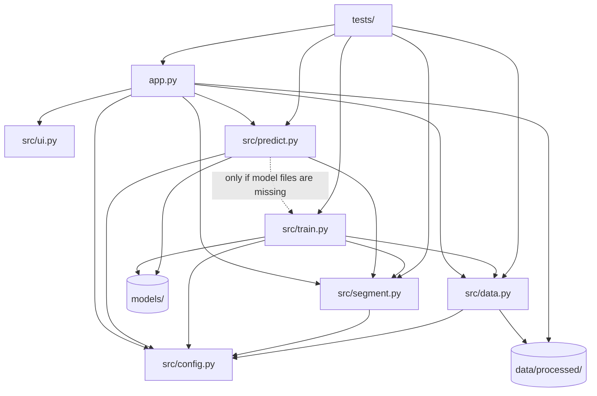

# Project Walkthrough: Customer Segmentation with K-Means

A beginner-friendly guide to **every file** in this project: what it does, how its important functions
work, and how half a million raw shop transactions become four customer segments, and how a customer you
type into the website gets assigned to one of them.

Everything here describes the code as it exists in this repository. Numbers marked *real* were produced by
running the actual saved model.

**How to read this:** Sections 1–3 give the big picture. Section 4 is a map of all files. Section 5 explains
each file. Section 6 traces one customer through the website step by step. Section 7 explains how the
segments were built. Section 9 is a glossary.

---

## Contents
1. [The project in one minute](#1-the-project-in-one-minute)
2. [Ideas you need first](#2-ideas-you-need-first)
3. [The three stages: data, training, app](#3-the-three-stages-data-training-app)
4. [Map of every file](#4-map-of-every-file)
5. [File-by-file explanation](#5-file-by-file-explanation)
6. [End-to-end flow: scoring a customer on the website](#6-end-to-end-flow-scoring-a-customer-on-the-website)
7. [Training flow: how the segments were built](#7-training-flow-how-the-segments-were-built)
8. [How the files depend on each other](#8-how-the-files-depend-on-each-other)
9. [Glossary](#9-glossary)

---

## 1. The project in one minute

A UK online gift shop recorded every sale for a year (Dec 2010 – Dec 2011): 541,909 lines of transactions.
This project groups its **4,334 customers** into **segments**, groups of customers who buy in similar ways, so
the shop could treat each group differently.

The website lets you:
- see the four segments, how big they are and how much revenue each brings (e.g. *Champions*: 16% of customers but 64% of revenue);
- **score a customer**: type in how they buy and see which segment they belong to;
- see how the number of segments was chosen, and re-group the customers with a different number;
- download the customer list of any segment.

This is **unsupervised learning**: the data has **no correct answers (no labels)**. Nobody told the computer
which customers are "Champions". The algorithm finds groups of similar customers by itself, and we describe
and name those groups afterwards. (Its opposite, *supervised learning*, learns from labelled examples.)

---

## 2. Ideas you need first

| Idea | Plain meaning | In this project |
|---|---|---|
| **Transaction line** | One product line on one invoice | e.g. "6 × heart T-light holder, £2.55 each" |
| **Feature** | A number describing each item we group | 3 numbers per customer: R, F, M (below) |
| **Clustering** | Automatically grouping similar items | Grouping customers |
| **Cluster / segment** | One group found by clustering | e.g. "Champions" |
| **Centroid (cluster centre)** | The average point of a cluster | The "typical" customer of a segment |
| **RFM** | A classic marketing description of a customer | **R**ecency, **F**requency, **M**onetary value |

**RFM in detail:**
- **Recency**: days since the customer's last purchase (lower = more recent = better).
- **Frequency**: number of separate orders (invoices).
- **Monetary**: total amount spent, in £.

---

## 3. The three stages: data, training, app



The customer table (`rfm.csv`) and the trained model are **included** in the repository, so the app works
immediately and offline. The raw 23 MB file is only needed to rebuild the table (stage 1).

---

## 4. Map of every file

```
customer-segmentation-kmeans/
├── app.py                         ← the website (Streamlit): 5 tabs, charts, scoring form, export
├── src/
│   ├── __init__.py                ← empty; makes src/ an importable Python package
│   ├── config.py                  ← settings: paths, URL, codes to remove, k ranges, input limits
│   ├── data.py                    ← download, clean transactions, compute R/F/M per customer
│   ├── segment.py                 ← K-Means pipeline + ranking, naming and describing segments
│   ├── train.py                   ← tries several k, chooses k, fits, checks stability, saves
│   ├── predict.py                 ← validates input and assigns a new customer to a segment
│   └── ui.py                      ← styling helpers (banner, result card, footer)
├── data/
│   ├── processed/rfm.csv          ← one row per customer: R, F, M, country (included)
│   ├── processed/cleaning_stats.json ← row counts after each cleaning step (included)
│   └── raw/                       ← the 23 MB zip, downloaded when needed (NOT in the repository)
├── models/
│   ├── kmeans_model.joblib        ← the trained pipeline (log → scale → K-Means)
│   └── metrics.json               ← every number the website shows
├── tests/
│   ├── test_model.py              ← checks of cleaning, RFM, clustering, naming, scoring
│   └── test_app.py                ← checks of the website without a browser
├── docs/                          ← MODEL_CARD, DATA_SOURCES, DEVELOPMENT_LOG, TESTING
├── .streamlit/config.toml         ← light and dark theme colours
├── requirements.txt, pytest.ini, .gitignore, README.md
```

**Design rule:** `app.py` controls the look; `src/` does all computing and never imports Streamlit (the web
framework), so it can be tested without a browser.

---

## 5. File-by-file explanation

### 5.1 `src/config.py`: shared settings

| Constant | Meaning |
|---|---|
| `RAW_ZIP`, `RAW_URL`, `RAW_SHA256` | Where the raw zip goes, where to download it, and its *checksum* (a fingerprint used to verify the file is intact) |
| `RFM_PATH`, `CLEANING_PATH`, `MODEL_PATH`, `METRICS_PATH` | Output files |
| `NON_PRODUCT_CODES` | Stock codes that are not products: postage (`POST`, `DOT`), fees (`BANK CHARGES`, `AMAZONFEE`), discounts (`D`), manual adjustments (`M`), etc. |
| `RFM_FEATURES`, `RFM_LABELS` | The three feature names and their display labels |
| `K_RANGE = 2..10` | Numbers of segments to evaluate |
| `K_CANDIDATES = 3..6` | Numbers of segments allowed for the final choice (2 is too coarse for marketing; more than 6 is hard to act on) |
| `RANDOM_STATE = 42`, `N_INIT = 20` | Random seed (reproducible results) and how many times K-Means restarts from different starting points |
| `STABILITY_SEEDS = 10` | Repeats for the stability check |
| `LIMITS` | Allowed form input: recency 1–3650 days, orders 1–10,000, spend £0.01–£10,000,000 |

### 5.2 `src/data.py`: from transactions to customers

Run with `python -m src.data` (needs internet the first time; reading the Excel file takes about 1.5 minutes).

| Function | What it does |
|---|---|
| `download_raw()` | Downloads the zip if missing and checks its SHA-256 checksum |
| `load_transactions()` | Opens `Online Retail.xlsx` from the zip into a pandas **DataFrame** (a spreadsheet-like table) |
| `clean_transactions(df)` | **Data cleaning**: applies 5 rules in order and records how many rows each removes (see the table below). It then adds `Revenue = Quantity × UnitPrice` |
| `build_rfm(tx)` | Groups lines by customer (**aggregation**) and computes R, F, M (below) |
| `build_and_save()` | Runs the three steps above and saves `rfm.csv` and `cleaning_stats.json` |
| `load_rfm()`, `load_cleaning_stats()` | Read those files, building them first if missing |

**Cleaning rules (real counts):**

| Rule | Rows removed | Why |
|---|---|---|
| No `CustomerID` | 135,080 | Can't be linked to a customer |
| Invoice number starts with "C" | 8,905 | Cancellations, not purchases |
| Quantity or price ≤ 0 | 40 | Corrections or errors |
| Non-product code | 1,547 | Postage, fees, discounts aren't goods |
| Exact duplicate line | 5,187 | Probably entered twice |
| **Left** | **391,150 lines** | |

**How `build_rfm` computes the features:**
- **Snapshot date** = the day after the last transaction = **2011-12-10**. It's the "today" that recency is measured from.
- **Recency** = snapshot − date of the customer's last purchase, in days.
- **Frequency** = number of *distinct* invoices. One invoice has many lines, so counting lines would overcount.
- **Monetary** = sum of the customer's revenue.
- **Country** = the customer's most common country (kept for information only).

Real first rows of `rfm.csv`:

| CustomerID | recency | frequency | monetary | country |
|---|---|---|---|---|
| 12346 | 326 | 1 | 77,183.60 | United Kingdom |
| 12347 | 3 | 7 | 4,310.00 | Iceland |
| 12348 | 76 | 4 | 1,437.24 | Finland |

### 5.3 `src/segment.py`: the clustering model and the segment names

#### `make_pipeline(k)`: the model
A **Pipeline** (a chain of steps run in order) with 3 steps:

1. **`log` = `FunctionTransformer(np.log1p)`**: replaces each value x by `log(1 + x)`. The data is extremely **skewed** (most customers spend a few hundred pounds, a few spend tens of thousands; the maximum is £279,138). The log makes £300 → £3,000 the same size of step as £3,000 → £30,000, so a few huge customers don't dominate.
2. **`scale` = `StandardScaler()`**: **standardises** each feature to mean 0 and spread 1: `z = (x − mean) / std` (*std* = standard deviation, a measure of spread). Without it, the feature with the biggest numbers would dominate, because days, order counts and pounds are on different scales.
3. **`kmeans` = `KMeans(n_clusters=k, n_init=20)`**: the clustering algorithm.

**How K-Means works:**
1. Pick *k* starting centres. The *k-means++* method spreads them out.
2. **Assign** every customer to its nearest centre. "Nearest" is measured with **Euclidean distance**, ordinary straight-line distance: `√((R₁−R₂)² + (F₁−F₂)² + (M₁−M₂)²)`.
3. **Update** each centre to the average of the customers assigned to it.
4. Repeat steps 2–3 until nothing changes.

The total squared distance of customers to their centres is called **inertia**; K-Means tries to make it small.
Because the result depends on the starting centres, it is run **20 times** (`n_init=20`) and the best run is kept.

#### Making the clusters readable
K-Means numbers its clusters arbitrarily (cluster "0" is not special), so this file adds:

| Function | What it does |
|---|---|
| `scaled_centroids(model)` | The centres in the scaled space (in standard deviations from the average customer) |
| `centroids_original_units(model)` | The centres converted back to days, orders and £ (undoing the scaling, then the log) |
| `value_rank(model)` | Ranks clusters by **value score** = −R + F + M (scaled), so recent, frequent, high-spending customers rank first (rank 0 = most valuable) |
| `base_name(z)` | Names a centre with fixed rules (`NAMING_RULES`, below); it doesn't pick names by hand |
| `segment_names(model)` | Names in rank order; if a name appears twice, adds "(tier 2)" |
| `assign_segments(model, X)` | For a table of customers, returns each one's segment rank |
| `action_for`, `description_for` | Look up the text for a segment name |
| `profile(rfm, segments, names)` | Per-segment statistics: number of customers, share, revenue share, median and mean R/F/M |

**Naming rules** (`base_name`): `z_R` is the centre's recency in standard deviations (negative = more
recent than average), and `value = (z_F + z_M) / 2`:

| Recency | Value | Name |
|---|---|---|
| z_R ≤ −0.5 | ≥ 1 | Champions |
| z_R ≤ −0.5 | 0 – 1 | Loyal customers |
| z_R < 0.5 | < 0 | New or occasional |
| −0.5 < z_R < 0.5 | ≥ 0 | Regular mid-value |
| z_R ≥ 0.5 | ≥ 0 | At-risk valuable |
| z_R ≥ 0.5 | < 0 | Lapsed low-value |

`ACTIONS` and `DESCRIPTIONS` hold the text shown for each name. The **suggested actions are hypotheses**
written by people; the data doesn't show that they work.

### 5.4 `src/train.py`: choosing k and building the segments

Run with `python -m src.train` (about 20 seconds; uses `rfm.csv`).

> **Note:** the comment block at the very top of this file is out of date. It says "the highest silhouette
> among k = 3..6" and mentions only one stability check. The **code** below it does what this section
> describes: `choose_k` takes the largest k within 0.01 of the best silhouette, and `train()` runs two
> stability checks.

| Function | What it does |
|---|---|
| `evaluate_k(X)` | For k = 2…10: fits the pipeline and records 4 quality scores (below) |
| `choose_k(results)` | Among k = 3–6, the **largest k whose silhouette is within 0.01 of the best** |
| `stability(X, k, labels)` | Refits with 10 different random seeds and compares the groupings |
| `subsample_stability(X, k, labels)` | Refits 20 times, each on a random 80% of customers, and compares the groupings of all customers |
| `train()` | The whole procedure, plus building `metrics.json` |
| `main()` | Saves the model (`joblib`, a library that saves Python objects to files) and metrics (`JSON`, a plain-text data format), and prints a summary |

**The quality scores** (there's no "accuracy" without correct answers, so clustering uses these instead):
- **Inertia**: total squared distance to the centres. It always falls as k grows; the "**elbow**" in its curve is where adding groups stops helping much.
- **Silhouette score** (−1 to 1, higher is better): for each customer, compares how close they are to their own group with how close they are to the nearest other group, then averages over everyone. Around 0.3 means real but overlapping groups.
- **Davies–Bouldin index** (lower is better): how similar each group is to its most similar neighbour.
- **Calinski–Harabasz index** (higher is better): ratio of between-group spread to within-group spread.
- **Adjusted Rand Index (ARI)** (1 = identical, 0 = chance), used for stability: how much two groupings of the same customers agree.

Real results:

| k | silhouette |
|---|---|
| 2 | 0.433 |
| 3 | 0.338 |
| **4** | **0.336** |
| 5 | 0.318 |
| 6 | 0.313 |

k = 2 is excluded by design. k = 3 and k = 4 are within 0.01 of each other, so `choose_k` picks **4**.
Stability: seeds ARI **0.970**, 80% subsamples ARI **0.923**.

### 5.5 `src/predict.py`: assigning a new customer

| Function | What it does |
|---|---|
| `ensure_trained()` | Trains if the model or metrics file is missing |
| `load_model()`, `load_metrics()` | Read the saved files |
| `validate_customer(values)` | Errors for non-numbers, values outside `LIMITS`, or fractional orders |
| `range_warnings(values, ranges)` | Gentle warnings when a value is outside what real customers had (e.g. 500 orders, above the maximum of 206) |
| `score_customer(model, values)` | **Main function**: validates; applies the model's log + scaling steps (`model[:-1]`, i.e. every step except K-Means); computes the Euclidean distance to all 4 centres; picks the **nearest**. Returns the segment name and all distances |

### 5.6 `src/ui.py`: styling helpers
`inject_css()` (CSS = web styling rules, with colours that work in light and dark mode), `hero()` (banner
plus the light/dark-mode hint), `result_card()` (the "Assigned segment" box) and `footer()`. Text is
HTML-escaped (special characters are shown, never run as code). `style_fig`, `NEUTRAL` and `PLOT_MARGIN`
exist here but are not currently used by `app.py`.

### 5.7 `app.py`: the website

Built with **Streamlit**, which turns a Python script into a web page at http://localhost:8501. **Key fact:**
every interaction makes Streamlit **re-run the whole script**. Caching keeps this fast, and `st.session_state`
(per-visitor memory) keeps the form values.

| Function / constant | Role |
|---|---|
| `SEGMENT_COLORS`, `SEGMENT_ICONS`, `color_of()` | Fixed colour and icon per segment name (icons are the Material Symbols bundled with Streamlit) |
| `PRESETS` | Four example customers. The default is "Steady regular" (45 days, 4 orders, £1,200) |
| `get_model_and_metrics()` | Cached (`@st.cache_resource`): `ensure_trained()`, then load |
| `get_segmented(_model, trained_at)` | Cached (`@st.cache_data`): loads `rfm.csv` and adds each customer's segment name. The leading `_` in `_model` tells Streamlit not to use the model object itself as part of the cache key; `trained_at` is used instead |
| `explore_k(k)` | Cached: fits a **new** K-Means with any k from 2–8 for the "Explore other values of k" slider (exploration only; the rest of the app keeps k = 4) |
| `apply_preset(name)` | Button callback: puts a preset's values into the form |
| `log_scatter(...)` | Scatter chart of orders vs spend on **logarithmic axes** (each step on the axis is ×10), optionally with a pink star for the scored customer |
| `render_segments(df, metrics)` | **Segments** tab: totals, R/F/M explanation, segment cards with icon, description and suggested action, comparison table, customers vs revenue chart, "fingerprint" chart of the centres, 3-D scatter, box plots, CSV download |
| `render_score(model, df, metrics)` | **Score a customer** tab: presets, three number inputs, validation errors, result card, suggested action, warnings, distance chart, scatter with star |
| `render_choosing_k(metrics)` | **Choosing k** tab: rule, inertia/silhouette/Davies–Bouldin charts, table, both stability numbers, k explorer |
| `render_how_it_works(metrics)` | Steps, the K-Means objective, naming rules, limitations |
| `render_data(df, metrics)` | Cleaning-step table, raw vs log spending histogram, the customer table |
| `main()` | Page set-up → load model, metrics and segmented customers → default form values → banner → 5 tabs → footer |

The **CSV export** in `render_segments` filters the customer table to the chosen segment, sorts it by spend
and offers it via `st.download_button`.

Charts are drawn with **Plotly** (interactive charts).

### 5.8 `tests/`: automatic checks
Run with `python -m pytest`. *pytest* runs every `test_…` function; a test fails if an `assert` is false.

- **`test_model.py`** (22 cases):
  - **Cleaning:** each cleaning rule removes exactly the right row of a hand-made 6-row table.
  - **RFM:** a hand-calculated example (recency 5, frequency 2, monetary £21); `rfm.csv` is valid.
  - **Stored metrics:** segment sizes and silhouette recomputed from the saved model equal `metrics.json`.
  - **Ranking:** segment 0 has the highest median spend.
  - **k rule:** the rule works on known numbers.
  - **Naming:** all 6 naming rules (6 cases); names are unique.
  - **Scoring:** obvious customers get obvious segments (2 cases).
  - **Invalid input:** rejected (6 cases).
  - **Range warning.**
- **`test_app.py`** (3 tests) uses Streamlit's **AppTest** (runs the page without a browser):
  - all 5 tabs render;
  - scoring presets give "Champions" and "Lapsed low-value";
  - the k-explorer slider works.

### 5.9 Other files

| File | What it is |
|---|---|
| `models/kmeans_model.joblib` | Saved pipeline: log step, scaler (with learned means and stds) and K-Means centres |
| `models/metrics.json` | Cleaning stats, k evaluation, chosen k, stability, segment profiles, centres, medians, ranges |
| `.streamlit/config.toml` | Light and dark colours; enables ⋮ → Settings → Theme |
| `requirements.txt` | Exact library versions (`openpyxl` is needed to read the Excel file) |
| `pytest.ini`, `.gitignore` | Test settings; keeps `data/raw/`, caches and personal notes out of Git |

---

## 6. End-to-end flow: scoring a customer on the website

We follow the **default customer** ("Steady regular") with **real numbers**: last purchase **45 days** ago,
**4 orders**, **£1,200** spent.

```mermaid
sequenceDiagram
    participant You
    participant App as app.py (Score a customer tab)
    participant Pred as src/predict.py
    participant Model as Saved Pipeline<br/>(log1p → StandardScaler → K-Means)
    You->>App: enter 45 / 4 / 1200 (or click a preset)
    App->>App: rerun script; model comes from cache
    App->>Pred: validate_customer() → no errors
    App->>Pred: score_customer(model, values)
    Pred->>Model: model[:-1].transform: log, then scale
    Pred->>Pred: distance to each of the 4 centres → nearest
    Pred-->>App: "Regular mid-value" + all distances
    App-->>You: result card, suggested action, distance chart, star on scatter
```

**Step 1. Input.** The three `number_input` widgets give `{recency: 45, frequency: 4, monetary: 1200.0}`.
Clicking a preset first runs `apply_preset`, which fills these fields.

**Step 2. Validation.** `validate_customer` finds that all values are numbers within `LIMITS` and the order
count is whole, so there are no errors. *(1.5 orders would give "frequency must be a whole number of orders.")*

**Step 3. Log transform.** `log(1 + x)` gives **[3.829, 1.609, 7.091]**.

**Step 4. Standardise** with the means and stds learned from all 4,334 customers (in log space): mean
[3.859, 1.342, 6.575], std [1.307, 0.682, 1.255]. For example, recency: (3.829 − 3.859) / 1.307 = −0.023.
Result **z = [−0.023, 0.393, 0.411]**: recency about average, orders and spend a bit above average.

**Step 5. Distance to each centre.** The 4 real centres (in the same scaled space) and the Euclidean distances:

| Segment | Centre (R, F, M) | Distance from this customer |
|---|---|---|
| **Regular mid-value** | (0.08, 0.36, 0.54) | **0.169** ← nearest |
| New or occasional | (−0.78, −0.42, −0.44) | 1.397 |
| Lapsed low-value | (0.93, −0.76, −0.77) | 1.907 |
| Champions | (−1.26, 1.68, 1.41) | 2.045 |

For example: √((−0.023 − 0.08)² + (0.393 − 0.36)² + (0.411 − 0.54)²) ≈ 0.169.

**Step 6. Answer.** The nearest centre wins, so the customer is assigned to **Regular mid-value**. This is exactly
what K-Means' own `predict` does. The card shows the segment's description and its suggested action
(labelled a hypothesis).

**Step 7. Warnings and charts.** All values are within the observed ranges, so there are no warnings. *(500 orders
would warn: "frequency = 500 is outside the range seen in the data (1–206).")* The distance chart shows the
table above. The scatter chart shows all customers coloured by segment, with this customer as a pink star.

**Step 8.** Changing any number repeats steps 1–7 instantly; the model is not reloaded.

**Why was the Regular centre named "Regular mid-value"?** Its z_R = 0.08 lies between −0.5 and 0.5
("average recency"), and value = (0.36 + 0.54) / 2 = 0.45 ≥ 0. So the 4th naming rule applies.

---

## 7. Training flow: how the segments were built



Real result:

| Segment | Customers | Share of revenue | Median recency / orders / spend |
|---|---|---|---|
| Champions | 699 (16.1%) | 64.4% | 9 days / 10 / £3,683 |
| Regular mid-value | 1,159 (26.7%) | 24.0% | 53 days / 4 / £1,359 |
| New or occasional | 878 (20.3%) | 5.2% | 19 days / 2 / £440 |
| Lapsed low-value | 1,598 (36.9%) | 6.5% | 182 days / 1 / £300 |

The silhouette of about 0.34 means the groups **overlap**: customer behaviour is a continuum, and the four
segments are a useful division of it, not perfectly separate kinds of customer.

---

## 8. How the files depend on each other



`segment.py` is shared by training (to build and name clusters), by `predict.py` (to name the nearest
cluster) and by `app.py` (for the k explorer and profiles). That's why names are always consistent.

---

## 9. Glossary

| Term | Simple meaning |
|---|---|
| **Adjusted Rand Index (ARI)** | Agreement between two groupings of the same items (1 = identical, 0 = chance) |
| **Aggregation** | Combining many rows into one summary per group (e.g. per customer) |
| **AppTest** | Streamlit tool that runs the page in a test without a browser |
| **Caching** | Keeping a computed result for reuse |
| **Calinski–Harabasz index** | Between-group spread ÷ within-group spread (higher is better) |
| **Centroid** | The average point (centre) of a cluster |
| **Checksum (SHA-256)** | A fingerprint used to verify a file |
| **Cluster / segment** | A group of similar items found by clustering |
| **Clustering** | Grouping similar items without labels |
| **Data cleaning** | Removing or fixing unusable rows |
| **DataFrame** | A table object from pandas |
| **Davies–Bouldin index** | How similar clusters are to their nearest neighbour (lower is better) |
| **Elbow method** | Choosing k where the inertia curve stops dropping steeply |
| **Euclidean distance** | Straight-line distance between two points |
| **Feature** | A number describing each item |
| **Inertia** | Total squared distance from points to their cluster centres |
| **K-Means** | Clustering by repeatedly assigning points to the nearest centre and moving the centres |
| **k-means++** | A smart way to choose the starting centres |
| **Log transform (`log1p`)** | `log(1 + x)`: compresses large values, fixing skew |
| **Logarithmic axis** | A chart axis where each step multiplies the value (e.g. ×10) |
| **Median** | The middle value when sorted |
| **`n_init`** | How many times K-Means restarts from new starting centres |
| **Pipeline** | Processing steps chained into one object |
| **RFM** | Recency, Frequency, Monetary: a standard way to describe customers |
| **Session state** | Streamlit's per-visitor memory across reruns |
| **Silhouette score** | How much closer items are to their own cluster than to the next one (−1 to 1) |
| **Skewed data** | Data where a few values are much larger than most |
| **Snapshot date** | The reference "today" for measuring recency |
| **Stability** | Whether repeating the clustering gives the same groups |
| **Standardisation** | Rescaling to mean 0, spread 1 |
| **Supervised / unsupervised learning** | Learning with / without correct answers (labels) |
