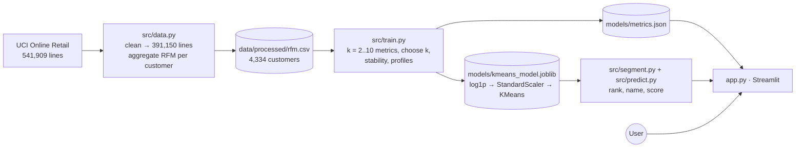

# 👥 Customer Segmentation with K-Means

A customer-analytics application that groups **4,334 real online-retail customers** into segments by
how **recently**, how **often** and how **much** they buy (RFM), profiles each segment from the data,
and suggests how a business could act on it.

**Author:** Arya Kumar · AI/ML internship project

---

## Problem statement

A retailer cannot treat thousands of customers individually, and treating them all the same wastes
marketing effort. The task is to discover natural groups of customers from transaction data, without
predefined labels (**unsupervised learning**), describe each group truthfully, and present the result
in a tool a marketing team could use.

### Objectives
1. Clean a real transactional dataset and engineer customer-level **Recency, Frequency, Monetary** features.
2. Apply K-Means with appropriate transformation and scaling, and justify the number of clusters with several metrics.
3. Check the stability of the segments and interpret them from the data, without invented insights.
4. Build an interactive application for exploring segments, scoring new customers and exporting segment lists.

## Features

| Tab | What it does |
|---|---|
| **Segments** | KPI row; one card per segment (share of customers and revenue, typical behaviour, suggested action); customer-vs-revenue share chart; segment "fingerprints"; rotatable 3-D scatter; box plots; **CSV export per segment** |
| **Score a customer** | Enter days since last purchase, orders and spend; get the segment, the distance to every segment centre and the customer's position on the map; four presets; validation and out-of-range warnings |
| **Choosing k** | Elbow (inertia), silhouette and Davies–Bouldin charts; full metrics table; stability (adjusted Rand index); **interactive re-clustering for k = 2–8** |
| **How it works** | Pipeline, K-Means objective, naming rules, limitations |
| **Data** | Cleaning steps with row counts, raw vs log-transformed spend, customer table, source and licence |

## Technology stack
Python 3.13 · scikit-learn 1.9 (KMeans, StandardScaler, silhouette / Davies–Bouldin / Calinski–Harabasz,
adjusted Rand index) · pandas · openpyxl · NumPy · Streamlit 1.66 · Plotly · joblib · pytest.

## Dataset
**Online Retail** (UCI Machine Learning Repository): all transactions of a UK-based online giftware
retailer, 01/12/2010–09/12/2011, 541,909 lines. Many customers are wholesalers.
Chen, D. (2015). *Online Retail* [Dataset]. UCI Machine Learning Repository.
https://doi.org/10.24432/C5BW33. **Licence: CC BY 4.0.**
The raw file (23 MB) is downloaded by `python -m src.data`; the derived customer table
(`data/processed/rfm.csv`, 150 KB) is committed. See [docs/DATA_SOURCES.md](docs/DATA_SOURCES.md).

## Architecture



## Quick start (Windows PowerShell)

Requires **Python 3.11 or newer** (tested with 3.13.1 on Windows 11). Run these from a PowerShell window:

```powershell
# 1. Go to the project folder (the one containing app.py)
cd path\to\customer-segmentation-kmeans

# 2. First time only: create a virtual environment and install the dependencies
py -3.13 -m venv C:\venvs\segments
C:\venvs\segments\Scripts\Activate.ps1
python -m pip install -r requirements.txt

# 3. Every time: activate the environment and start the app
C:\venvs\segments\Scripts\Activate.ps1
python -m streamlit run app.py
```

The app opens at **http://localhost:8501**. Stop it with `Ctrl + C`. Run the tests with `python -m pytest`
(25 tests).

- **Data:** The customer table the app uses (`data/processed/rfm.csv`) is included. The raw 23 MB file is only needed to rebuild it: `python -m src.data` (internet required; reading the Excel file takes ~1.5 min).
- **Model:** The trained model (`models/kmeans_model.joblib`) is included. Retrain (about 20 s): `python -m src.train`.
- **Light / dark mode:** open the **⋮** menu (top right) → **Settings** → **Theme**.

> The virtual environment is created at a short path outside the project folder on purpose: inside a long
> OneDrive path, Windows' 260-character path limit can break the installation (`WinError 206`), and
> OneDrive would sync ~500 MB of packages. If `py -3.13` is not available, use `python -m venv C:\venvs\segments`.

### Common startup problems

| Symptom | Fix |
|---|---|
| `Activate.ps1 cannot be loaded because running scripts is disabled` | Run `Set-ExecutionPolicy -Scope Process -ExecutionPolicy Bypass`, then activate again (affects this window only) |
| `streamlit` / `python` is not recognised, or `ModuleNotFoundError` | The environment is not active: run the `Activate.ps1` line again; always start the app with `python -m streamlit run app.py` |
| `ModuleNotFoundError: No module named 'src'` | You are not in the project folder; `cd` into the folder that contains `app.py` |
| `Port 8501 is already in use` | Another app is running; stop it, or use `python -m streamlit run app.py --server.port 8502` |
| `WinError 206: The filename or extension is too long` during `pip install` | Create the environment at a short path such as `C:\venvs\segments` (as above) |
| The browser does not open | Open http://localhost:8501 manually |

## Results

**Chosen k = 4** (silhouette 0.336, Davies–Bouldin 1.018). Stability (adjusted Rand index): **0.970** over 10
random restarts, and **0.923** over 20 refits on random 80% samples of customers.

| Segment | Customers | Revenue share | Median recency | Median orders | Median spend |
|---|---|---|---|---|---|
| **Champions** | 699 (16.1%) | **64.4%** | 9 days | 10 | £3,683 |
| **Regular mid-value** | 1,159 (26.7%) | 24.0% | 53 days | 4 | £1,359 |
| **New or occasional** | 878 (20.3%) | 5.2% | 19 days | 2 | £440 |
| **Lapsed low-value** | 1,598 (36.9%) | 6.5% | 182 days | 1 | £300 |

**Key finding (from the data):** 16% of customers generate 64% of revenue. Meanwhile 37% have bought only
about once and not for roughly six months.

**How k was chosen:** silhouette is highest at k = 2 (0.433), but a two-way split is too coarse for
distinct actions. Among k = 3–6, k = 3 (0.338) and k = 4 (0.336) are effectively tied, and k = 4
separates *new* customers from established *regulars*, who need different treatment. The rule is
documented, and it is a judgement call, not an objective optimum.

## Repository structure
```
customer-segmentation-kmeans/
├── app.py                     # Streamlit UI (5 tabs)
├── requirements.txt · pytest.ini · .gitignore · .streamlit/config.toml
├── data/processed/            # rfm.csv + cleaning_stats.json (raw zip is git-ignored)
├── src/
│   ├── config.py              # paths, URL + checksum, non-product codes, k ranges, limits
│   ├── data.py                # download, clean (logged steps), RFM aggregation
│   ├── segment.py             # pipeline, ranking, naming rules, actions, profiles
│   ├── train.py               # k evaluation, k rule, stability, metrics
│   ├── predict.py             # validation, scoring a new customer
│   └── ui.py                  # styling helpers
├── models/                    # kmeans_model.joblib + metrics.json
├── tests/                     # test_model.py (22) + test_app.py (3)
└── docs/                      # MODEL_CARD · DEVELOPMENT_LOG · DATA_SOURCES · TESTING
```

## Limitations
- RFM ignores *what* customers buy, margins and returns; one retailer, one year (2010–11).
- Silhouette of about 0.34 means segments overlap: behaviour is a continuum, and boundary customers could fit a neighbouring segment.
- K-Means assumes compact, similarly sized clusters and always returns k groups.
- Suggested actions are **hypotheses**; their effect has not been measured.

## Future improvements
- Add product-category and return-rate features; compare with Gaussian mixtures or hierarchical clustering.
- Track segment movement over time (monthly snapshots); test the suggested actions with A/B experiments.

## Documentation
[Model card](docs/MODEL_CARD.md) · [Development log](docs/DEVELOPMENT_LOG.md) ·
[Data sources](docs/DATA_SOURCES.md) · [Testing](docs/TESTING.md)
